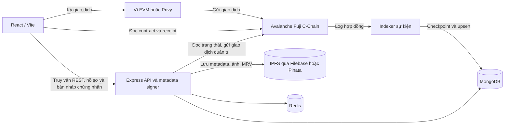

# SALX · Carbon Credit Marketplace trên Avalanche

**SALX là dApp trên Avalanche Fuji C-Chain để nộp hồ sơ MRV, thẩm định dự án, giao dịch SAL và retire tín chỉ để nhận chứng nhận Soulbound.**

[](https://vercel.com/salx/salx-avalanche/Bij3n3FRXXNzzT4FN2YbtBBShiVM)
[](#giấy-phép-license)
[](frontend/package.json)
[](#triển-khai-deployment)

**Giai đoạn hiện tại · Testnet công khai** · Team1 Vietnam UniHack 2026

[Website](https://salx-avalanche.vercel.app/) · [Marketplace](https://salx-avalanche.vercel.app/marketplace) · [Xác minh SBT #2](https://salx-avalanche.vercel.app/verify/2) · [Bằng chứng on-chain](https://salx-avalanche.vercel.app/proof)

Badge build trỏ tới deployment frontend đã xác nhận trên Vercel ở `ed96d3b`. Phiên bản `0.1.0` lấy từ manifest frontend.

## Tổng quan (Overview)

SALX phục vụ chủ dự án cần công khai hồ sơ giảm phát thải, validator cần ghi nhận kết quả thẩm định và cá nhân hoặc tổ chức cần mua lượng nhỏ để thử luồng bù trừ. Hồ sơ MRV (đo lường, báo cáo và thẩm tra) được tham chiếu bằng URI IPFS. Hợp đồng ghi phiếu thẩm định, lượng SAL phát hành và giao dịch retire để người khác đối chiếu.

**1 SAL đại diện cho 10 kg CO₂e theo quy ước của giao thức.** Mỗi dự án có một token ID ERC-1155. Khi retire, hợp đồng đốt số SAL đã dùng và cấp một chứng nhận Soulbound có thể kiểm tra công khai. Cơ chế đốt ngăn các đơn vị SAL đó được dùng lại trong SALX. Hiện dự án chưa tích hợp registry tín chỉ carbon chính thức và bản Fuji chỉ dùng AVAX testnet.

## Tính năng chính (Features)

| Tính năng | Luồng hiện tại |
| --- | --- |
| Nộp hồ sơ MRV | Chủ dự án tải hồ sơ lên IPFS, gửi URI qua `submitProject` và đặt cọc phí tokenization. Hồ sơ trong trạng thái chờ có thể hủy để ghi có tiền cọc. |
| Thẩm định và phát hành | Tại thời điểm nộp, hợp đồng chốt danh sách validator đủ điều kiện, loại chủ dự án và tính quorum là quá bán. Validator bỏ phiếu một lần. Owner gọi `approveAndMintSAL` khi đạt quorum. Lượng duyệt phải là bội số của 10 kg và trong giới hạn đã đề xuất. |
| Marketplace | Người bán đưa SAL vào escrow qua `createListing`. Người mua có thể mua một phần niêm yết. Phí sàn mặc định 2% và có thể điều chỉnh on-chain. Người bán rút tiền qua `withdrawProceeds`. |
| Ước tính lượng phát thải và giá | Chọn kịch bản trên trang chủ để nhận gợi ý số SAL. Giá thanh toán là AVAX. Phần USDC/VNĐ là quy đổi tham chiếu cố định được định nghĩa ở [currency.ts](frontend/src/lib/currency.ts). |
| Mua, retire và nhận SBT | Checkout hỗ trợ mua riêng hoặc mua rồi retire trong cùng giao diện. Ví xác nhận giao dịch mua, cấp quyền ERC-1155 nếu cần, rồi xác nhận retire. Luồng `/retire` cho phép gộp SAL từ 1–5 dự án vào một SBT. |
| Xác minh và chia sẻ | Trang `/verify/:tokenId` đọc trực tiếp SBT trên Fuji, đối chiếu bản ghi API khi có, cung cấp QR, liên kết Snowtrace, tải ảnh và nút **Export ESG Audit PDF** qua hộp thoại in của trình duyệt. |

## Kiến trúc (Architecture)



| Thành phần | Trách nhiệm |
| --- | --- |
| `SAL1155` | Token ERC-1155 theo từng dự án. Marketplace đã cấu hình kiểm soát việc mint và đốt SAL. |
| `SALMarketplace` | Quản lý vòng đời dự án, validator, escrow, phí và retire. |
| `GreenCertificateSBT` | ERC-721 không chuyển nhượng, lưu lượng SAL theo từng dự án nguồn và hỗ trợ thu hồi chứng nhận. |
| Frontend | React 19, TypeScript, Vite, ethers. Giao dịch được ký bằng Core, MetaMask, Coin98 hoặc ví nhúng Privy khi cấu hình. |
| API và metadata signer | Express phục vụ dự án, niêm yết, lịch sử và chứng nhận. Backend tạo metadata, tải lên IPFS và ký EIP-712 sau khi kiểm tra điều kiện on-chain. |
| Indexer và lưu trữ | Indexer quét log theo từng đoạn block, chờ số xác nhận theo cấu hình và lưu checkpoint theo hợp đồng. MongoDB lưu dữ liệu truy vấn. Redis tăng tốc truy vấn lịch sử giao dịch. |
| Dữ liệu giá | Tỷ giá quy đổi nằm trong frontend. Luồng thanh toán hiện dùng AVAX và không gọi oracle giá. |

Khi retire, `SALMarketplace` kiểm tra chữ ký EIP-712, `nonce`, hạn hiệu lực và phí, rồi đốt SAL và mint SBT trong **cùng một giao dịch retire**. Frontend đọc ID chứng nhận từ receipt để hiển thị trước khi bản ghi đầy đủ sẵn sàng. API cũng có thể dựng lại bản ghi từ receipt khi indexer chưa xử lý.

## Cài đặt (Getting Started)

- **Node.js 22.x từ 22.13.0** và npm. Hardhat 3.8.0, Solidity 0.8.28 và các phiên bản thư viện được quản lý trong repo. Các ví dụ dùng Bash hoặc Git Bash.
- **Docker Engine và Docker Compose v2** nếu chạy backend cùng MongoDB và Redis bằng cấu hình có sẵn.
- **Ví EVM và AVAX Fuji** cho các bước ghi on-chain. [Core faucet](https://core.app/tools/testnet-faucet)

```bash
git clone https://github.com/MasonTahieu/SALX-Avalanche.git
cd SALX-Avalanche
cp frontend/.env.example frontend/.env
cp backend/.env.example backend/.env
cp smart-contract/.env.example smart-contract/.env
```

Điền cấu hình theo các file mẫu. Địa chỉ và block trong mục [Triển khai](#triển-khai-deployment) dùng được cho bản Fuji đã công bố. Khi dùng deployment riêng, cập nhật cả ba địa chỉ ở frontend và backend.

| File mẫu | Cấu hình cần chú ý |
| --- | --- |
| [Frontend](frontend/.env.example) | `VITE_API_URL`, chain ID, RPC, explorer và ba biến địa chỉ hợp đồng. `VITE_PRIVY_APP_ID` và `VITE_PRIVY_CLIENT_ID` là tùy chọn. Biến `VITE_*` có thể xuất hiện trong bundle công khai. |
| [Backend](backend/.env.example) | `RPC_URL`, `CHAIN_ID`, ba địa chỉ và ba block triển khai, `MONGODB_URI` và `REDIS_URL`. Docker Compose đặt URI nội bộ cho MongoDB và Redis. Chọn Filebase hoặc Pinata để tải IPFS. Cấu hình `METADATA_SIGNER_PRIVATE_KEY` khớp signer on-chain cho luồng retire, và thông tin xác thực quản trị nếu thử duyệt dự án. |
| [Smart contracts](smart-contract/.env.example) | `DEPLOYER_PRIVATE_KEY` và RPC tương ứng cho deploy. Compile và test cục bộ không cần khóa ví Fuji. |

Giữ private key, thông tin xác thực IPFS và `ADMIN_SECRET_KEY` trong môi trường riêng. Với luồng ghi đầy đủ, dùng deployment Fuji riêng để kiểm soát vai trò owner, validator và metadata signer. Các lệnh bên dưới chạy từ thư mục gốc, trong hai terminal.

```bash
# Terminal 1 · API, MongoDB replica set và Redis
cd backend
docker compose up -d --build
docker compose exec -T app npm run check
```

```bash
# Terminal 2 · frontend, mặc định http://localhost:5173
npm --prefix frontend ci
npm --prefix frontend run dev
```

## Sử dụng (Usage)

- **Thử không cần ví.** Mở [SBT #2](https://salx-avalanche.vercel.app/verify/2) để xem lượng CO₂e đã retire, dự án đóng góp và giao dịch trên Fuji. Dùng **Export ESG Audit PDF** rồi chọn lưu dưới dạng PDF trong hộp thoại in.
- **Thử giao dịch trên Fuji.** Kết nối ví có AVAX testnet, vào [Marketplace](https://salx-avalanche.vercel.app/marketplace), chọn số SAL và xác nhận từng bước trong ví. Vào `/retire` nếu đã có SAL từ một hoặc nhiều dự án.
- **Thử luồng chủ dự án.** Nộp hồ sơ ở `/submit`, nhờ validator đủ điều kiện bỏ phiếu ở `/validator`, sau đó owner duyệt và mint. Chủ dự án có thể niêm yết SAL từ dashboard.

```bash
# API đọc trên bản local
curl -fsS http://localhost:5000/api/health/live
curl -fsS 'http://localhost:5000/api/listings?active=true'

# Compile Solidity từ thư mục gốc
npm --prefix smart-contract ci
npm --prefix smart-contract run compile
```

## Triển khai (Deployment)

| Mạng | Chain ID | Hardhat network | Trạng thái SALX |
| --- | --- | --- | --- |
| Avalanche Fuji C-Chain | `43113` | `fuji` | Bản testnet công khai đang chạy |
| Avalanche C-Chain | `43114` | `avalanche` | Có cấu hình mạng, chưa công bố deployment mainnet |

[Thông số C-Chain trong tài liệu Avalanche](https://docs.avax.network/docs/primary-network)

### Hợp đồng đã công bố trên Fuji

| Contract | Địa chỉ trên Snowtrace | Block triển khai |
| --- | --- | ---: |
| `SAL1155` | [`0xb525976C24285B3D87033FD3A3E74deDdF6878f7`](https://testnet.snowtrace.io/address/0xb525976C24285B3D87033FD3A3E74deDdF6878f7#code) | 60494921 |
| `SALMarketplace` | [`0xBb1d739d98dAe76DD1E95e4A978Fd1E4b525ABa4`](https://testnet.snowtrace.io/address/0xBb1d739d98dAe76DD1E95e4A978Fd1E4b525ABa4#code) | 60494928 |
| `GreenCertificateSBT` | [`0xb6093FBE46BA1C0222F0D24D829EB7f310d314c7`](https://testnet.snowtrace.io/address/0xb6093FBE46BA1C0222F0D24D829EB7f310d314c7#code) | 60494919 |

Cả ba contract đã công khai mã nguồn trên Snowtrace. Địa chỉ và hồ sơ triển khai gốc nằm trong [journal Ignition của Fuji](smart-contract/ignition/deployments/chain-43113/).

### Deploy một bộ hợp đồng Fuji riêng

Từ `smart-contract/`, cài dependency bằng `npm ci` và điền khóa của ví Fuji dành cho deployment. Dùng ID mới để giữ journal riêng. Nếu owner cũng nộp dự án, thêm ít nhất một validator độc lập trước khi nộp.

```bash
npm run deploy:fuji -- --deployment-id fuji-dev
npx hardhat ignition verify fuji-dev --network fuji
```

Module Ignition deploy ba hợp đồng, gắn hai token với marketplace rồi khóa địa chỉ marketplace. Lấy địa chỉ từ `ignition/deployments/fuji-dev/deployed_addresses.json` và block từ receipt hoặc explorer. Sau khi verify, mở mục **Contract / Code** của từng địa chỉ trên Snowtrace để kiểm tra nguồn đã xuất hiện. Hardhat dùng Solidity 0.8.28, optimizer 200 runs và `viaIR`. [Module Ignition](smart-contract/ignition/modules/CarboX.ts) · [Hardhat config](smart-contract/hardhat.config.js)

Nếu ABI thay đổi, chạy `npm run compile` rồi `npm run export:abis` trong `smart-contract/` để xuất vào `backend/abis/`. Đồng bộ ABI frontend ở `frontend/src/contracts/abis/` từ cùng artifact.

### Mainnet và hosting

Khi dự án sẵn sàng lên mainnet, cấu hình một ví triển khai riêng và rà soát quyền owner, validator và metadata signer. Module mặc định lấy ví triển khai làm signer. Để chỉ định ví khác, tạo file tham số JSON với cấu trúc `{"CarboXSALModule":{"metadataSigner":"<địa chỉ signer>"}}` và dùng tùy chọn `--parameters`.

```bash
# Từ smart-contract/, sau khi cấu hình ví mainnet và params.mainnet.json
npx hardhat ignition deploy ignition/modules/CarboX.ts \
  --network avalanche --deployment-id avalanche-mainnet --parameters params.mainnet.json
npx hardhat ignition verify avalanche-mainnet --network avalanche
```

Cấu hình đồng nhất RPC, chain ID, địa chỉ và block triển khai cho frontend, API và indexer của môi trường mới.

Frontend công khai chạy tại Vercel với thư mục gốc `frontend/` và lệnh build `npm run build`. API chạy trên Render với thư mục `backend/`, cài bằng `npm ci` và khởi động bằng `npm start`. Các dịch vụ lưu trữ dùng MongoDB, Redis và IPFS. Sau triển khai, đối chiếu lần lượt liveness, báo cáo health, Marketplace và một chứng nhận mẫu. [API liveness](https://salx-avalanche-api.onrender.com/api/health/live) · [Báo cáo health](https://salx-avalanche-api.onrender.com/api/health)

## Kiểm thử (Testing)

Chạy `npm ci` trong từng package trước khi kiểm thử. Các lệnh sau chạy từ thư mục gốc.

| Phạm vi | Lệnh |
| --- | --- |
| Solidity và flow tích hợp trên chain mô phỏng Hardhat | `npm --prefix smart-contract test` |
| Backend, gồm kiểm tra cú pháp và các bộ test API/dịch vụ | `npm --prefix backend run test:backend` |
| Frontend, gồm formatter, hook và tương tác React | `npm --prefix frontend test` |
| Một bộ test frontend | `npm --prefix frontend test -- src/__tests__/lib/currency.test.ts` |
| TypeScript và build frontend | `npm --prefix frontend run build` |

Trong `smart-contract/`, dùng `npx hardhat test mocha test/MarketplaceFlow.test.js` để chạy riêng luồng niêm yết và mua. Dùng `npx hardhat test --coverage` để đo coverage và tạo báo cáo HTML trong `smart-contract/coverage/html/`. Tại `ed96d3b`, 32 test hợp đồng đạt **80,03% line coverage** và **72,53% statement coverage** cho ba contract. Repo chưa cấu hình bộ fork test. Các bước kiểm thử trên Fuji được thực hiện riêng với ví testnet.

Khi chạy bộ test backend trên clone mới, điền ba địa chỉ hợp đồng hợp lệ vào `backend/.env` hoặc biến môi trường. Test health cần các địa chỉ này để kiểm tra cách API báo lỗi khi thiếu RPC.

## Bảo mật (Security)

**Chưa công bố báo cáo audit bảo mật độc lập hoặc chương trình bug bounty.** PDF ESG là bản tóm tắt dữ liệu chứng nhận retire. Phạm vi hiện tại là thử nghiệm trên Fuji.

- Hợp đồng dùng quyền owner và snapshot validator, khóa marketplace trên hai token, chữ ký EIP-712 có `nonce` và `deadline`, cùng cơ chế chống reentrancy, tạm dừng và blacklist. Owner có thể thu hồi SBT.
- Quyền quản trị backend dựa trên `x-admin-key` và các ví dịch vụ cấu hình sẵn. Tách quyền owner, validator và metadata signer khi thiết kế môi trường vận hành thật.
- Báo vấn đề bảo mật riêng qua địa chỉ liên hệ dự án. Gửi commit hoặc phiên bản, mạng, thành phần bị ảnh hưởng và mô tả tác động. Giữ private key, secret và thông tin riêng tư bên ngoài báo cáo. [Email dự án](mailto:hello@salx.io) · [GitHub Security](https://github.com/MasonTahieu/SALX-Avalanche/security)

## Cấu trúc thư mục (Project Structure)

```text
SALX-Avalanche/
├── frontend/
│   ├── src/pages/             Trang chủ, Marketplace, hồ sơ, retire, proof và verify
│   ├── src/components/        UI và hook nghiệp vụ
│   ├── src/services/          Kết nối REST API, ví và hợp đồng
│   ├── src/contracts/abis/    ABI dùng trên frontend
│   └── src/__tests__/         Vitest
├── backend/
│   ├── routes/                Endpoint REST
│   ├── services/              Indexer, IPFS, metadata, ảnh chứng nhận
│   ├── Models/                Mongoose schema
│   ├── abis/                  ABI dùng trên backend
│   └── scripts/               Kiểm tra cấu hình, test và công cụ dữ liệu
└── smart-contract/
    ├── contracts/             Ba hợp đồng Solidity
    ├── ignition/              Module và hồ sơ triển khai
    ├── scripts/               Công cụ xuất ABI và cấu hình hợp đồng
    └── test/                  Hardhat / Mocha
```

## Đóng góp (Contributing)

1. Mở issue cho lỗi hoặc đề xuất thông thường. Nêu network, bước tái hiện, kết quả mong đợi và commit đang dùng. [GitHub Issues](https://github.com/MasonTahieu/SALX-Avalanche/issues)
2. Tạo nhánh từ `main`, giữ PR tập trung vào một thay đổi và chạy build hoặc test cho phần bị ảnh hưởng.
3. Dùng tiêu đề commit ngắn mô tả thay đổi. Các tiền tố `feat:`, `fix:` hoặc `docs:` là quy ước đề xuất. Trong PR, ghi rõ tác động tới dữ liệu, ABI hoặc deployment nếu có. [GitHub Pull Requests](https://github.com/MasonTahieu/SALX-Avalanche/pulls)

## Giấy phép (License)

Ba hợp đồng Solidity khai báo `SPDX-License-Identifier: MIT`. Manifest backend ghi `ISC` và giấy phép font được lưu riêng. Repo hiện chưa có file `LICENSE` cấp gốc. [Hợp đồng Solidity](smart-contract/contracts/) · [Manifest backend](backend/package.json) · [Giấy phép font](backend/assets/fonts/OFL.txt)

## Liên hệ và tài nguyên

- **Maintainer** · [MasonTahieu](https://github.com/MasonTahieu) · [hello@salx.io](mailto:hello@salx.io)
- **Sản phẩm và bằng chứng** · [SALX trên Fuji](https://salx-avalanche.vercel.app/) · [Proof](https://salx-avalanche.vercel.app/proof) · [SBT #2](https://salx-avalanche.vercel.app/verify/2)
- **Tài liệu và mã nguồn liên quan** · [Avalanche Builder Hub](https://docs.avax.network/) · [Hardhat Ignition](https://hardhat.org/docs/guides/deployment/using-ignition) · [Repo SALX ban đầu trên Ethereum Sepolia](https://github.com/MasonTahieu/SALX)

Repo hiện chưa công bố whitepaper hoặc kênh Discord/Telegram chính thức.
