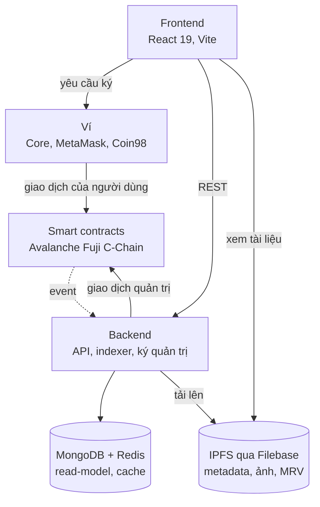
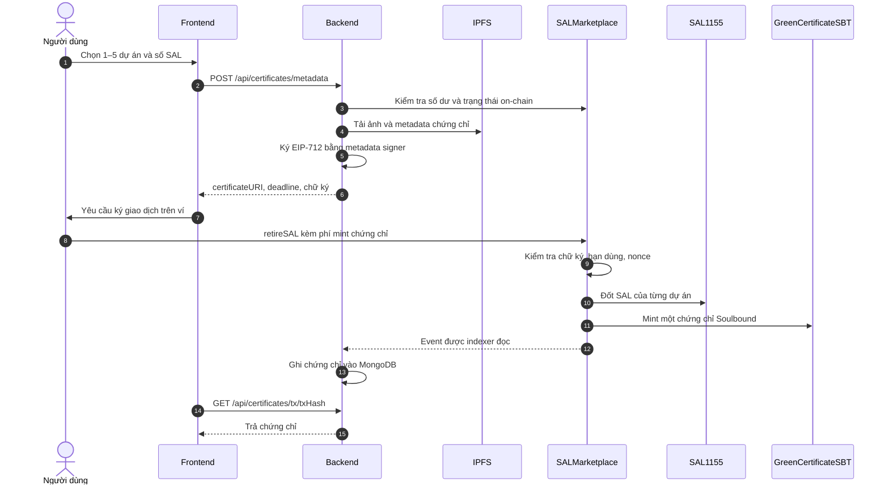

# SALX: Sàn tín chỉ carbon minh bạch trên Avalanche

> Phiên bản Avalanche của SALX, tham gia **Team1 Vietnam UniHack 2026**. Mã nguồn gốc chạy trên Ethereum Sepolia được giữ nguyên tại [MasonTahieu/SALX](https://github.com/MasonTahieu/SALX).

SALX (tên nội bộ: CarboX) là một marketplace tín chỉ carbon chạy on-chain. Dự án giảm phát thải (rừng, rừng ngập mặn, điện mặt trời, điện gió...) được cộng đồng validator thẩm định rồi token hoá thành **SAL**. SAL có thể mua bán tự do trên sàn, và khi người dùng "retire" (sử dụng) tín chỉ để bù đắp phát thải, hệ thống cấp một **chứng chỉ xanh Soulbound** không thể chuyển nhượng làm bằng chứng vĩnh viễn.

> **1 SAL = 10 kg CO2e**

**🌐 Website demo:** [salx-avalanche.vercel.app](https://salx-avalanche.vercel.app) (chạy trên Avalanche Fuji testnet, kết nối ví Core hoặc MetaMask để giao dịch)

## Vấn đề và giải pháp

| Vấn đề của thị trường carbon truyền thống | Cách SALX giải quyết |
|---|---|
| Quy trình thẩm định khép kín, khó kiểm chứng | Validator bỏ phiếu on-chain. Danh sách validator và quorum được chốt ngay lúc dự án nộp hồ sơ nên không thể thao túng về sau |
| Một tín chỉ có thể bị bán hoặc tính hai lần (double counting) | Retire sẽ **đốt** SAL. Chứng chỉ là token Soulbound, không bán lại được |
| Hồ sơ MRV khó truy xuất | Ảnh và tài liệu MRV được lưu trên IPFS. Metadata gắn với dự án on-chain |
| Người mua nhỏ lẻ khó tiếp cận | Mua lẻ từng SAL (10 kg CO2e), gộp tối đa 5 dự án vào một chứng chỉ |

## Luồng nghiệp vụ chính

```
Chủ dự án ──nộp hồ sơ + đặt cọc──▶ Validator bỏ phiếu ──đạt quorum──▶ Admin duyệt & mint SAL
                                                                              │
Người mua ◀──────────── mua SAL trên marketplace ◀──── chủ dự án niêm yết ◀──┘
    │
    └──retire SAL (đốt token)──▶ nhận Green Certificate (Soulbound NFT)
```

1. **Nộp dự án**: chủ dự án điền thông tin (lượng CO2 đề xuất, loại dự án, địa điểm, phương pháp luận, ngày giám sát) và tải tài liệu MRV lên IPFS. Khi gửi giao dịch `submitProject`, chủ dự án đặt cọc phí tokenization.
2. **Thẩm định**: validator gọi `voteOnProject`. Quorum = (số validator đủ điều kiện / 2) + 1, trong đó chủ dự án không được tự bỏ phiếu cho mình.
3. **Duyệt & mint**: khi đạt quorum, admin gọi `approveAndMintSAL` với lượng CO2 được duyệt. Nếu lượng được duyệt thấp hơn lượng đề xuất, phần phí thừa được hoàn lại. Chủ dự án có thể huỷ hồ sơ đang chờ để nhận lại toàn bộ cọc.
4. **Giao dịch**: chủ dự án niêm yết (`createListing`). SAL được giữ trong escrow của contract. Người mua có thể mua một phần hoặc toàn bộ (`buySAL`). Sàn thu phí 2%, người bán rút tiền qua `withdrawProceeds`.
5. **Retire**: người dùng chọn 1–5 dự án nguồn. Backend tạo metadata và ký uỷ quyền EIP-712 (có `nonce` và `deadline`). Contract kiểm tra chữ ký, đốt SAL và mint **một** chứng chỉ SBT duy nhất.

## Kiến trúc hệ thống (Architecture)

SALX gồm ba lớp: **smart contract giữ dữ liệu gốc**, **backend phục vụ truy vấn và chuẩn bị dữ liệu**, **frontend cùng ví của người dùng thực hiện giao dịch**. Nếu backend ngừng hoạt động, SAL và chứng chỉ vẫn nằm nguyên on-chain. Chỉ phần truy vấn và các thao tác cần backend bị gián đoạn.

### Tổng quan



### Thành phần

#### Smart contracts (`smart-contract/`)

| Contract | Chuẩn | Vai trò |
|---|---|---|
| `SAL1155` | ERC-1155 | Token tín chỉ carbon. Mỗi `projectId` là một loại token. Hỗ trợ blacklist theo dự án |
| `GreenCertificateSBT` | ERC-721 Soulbound | Chứng chỉ retire, không chuyển nhượng được. Lưu thành phần (dự án + số SAL) on-chain, có thể bị thu hồi khi phát hiện gian lận |
| `SALMarketplace` | — | Trung tâm điều phối: nộp/bỏ phiếu/duyệt dự án, niêm yết, mua bán, retire, quản lý phí và treasury |

Chỉ `SALMarketplace` được mint và đốt SAL hoặc mint chứng chỉ (`onlyMarketplace`), và địa chỉ này đã bị khoá vĩnh viễn sau khi deploy (`lockMarketplace`).

Các cơ chế an toàn khác: `ReentrancyGuard`, `Pausable`, blacklist ví và dự án, chữ ký EIP-712 có `nonce` và `deadline` để chống giả mạo metadata chứng chỉ.

#### Backend (`backend/`)

Node.js + Express, MongoDB, Redis, IPFS qua Filebase (hoặc Pinata), ethers.js.

| Module | Vị trí | Vai trò |
|---|---|---|
| REST API | `routes/` | `/api/projects`, `/api/listings`, `/api/certificates`, `/api/fees`, `/api/transactions`, `/api/leaderboard`, `/api/users`, `/api/upload/ipfs`, `/api/health`, `/api/admin/blockchain/*` |
| Indexer | `services/blockchainListener.js` | Đồng bộ event của 3 contract về MongoDB |
| Metadata dự án | `services/projectMetadataService.js` | Tạo metadata hồ sơ dự án và tải lên IPFS |
| Metadata chứng chỉ | `services/certificateMetadataService.js`, `services/certificateArtwork.js` | Kiểm tra số dư on-chain, sinh ảnh chứng chỉ (SVG → PNG), ký EIP-712 |
| Giao dịch quản trị | `services/blockchainService.js` | Gửi giao dịch duyệt dự án, tạm dừng, blacklist bằng ví quản trị |
| Lưu trữ IPFS | `services/ipfsService.js` | Tải tệp lên Filebase hoặc Pinata |
| Vận hành | `services/startupService.js`, `services/healthService.js` | Trình tự khởi động và báo cáo tình trạng hệ thống |

#### Frontend (`frontend/`)

React 19 + TypeScript + Vite + Tailwind CSS 4, ethers.js, hỗ trợ song ngữ và chế độ sáng/tối. Danh sách dự án và lịch sử được đọc qua REST API, còn giao dịch của người dùng được gửi thẳng tới contract qua ví (`src/services/blockchain.ts`).

| Trang | Đường dẫn | Chức năng |
|---|---|---|
| Trang chủ | `/` | Thống kê tổng: dự án đã duyệt, lượng carbon đang lưu hành và đã retire |
| Marketplace | `/marketplace` | Duyệt, lọc, sắp xếp và mua SAL |
| Nộp dự án | `/submit` | Form nhiều bước, tải tài liệu MRV |
| Retire | `/retire` | Chọn dự án nguồn, retire và nhận chứng chỉ |
| Dashboard | `/dashboard` | Số dư SAL, niêm yết, dự án, chứng chỉ, tiền chờ rút |
| Validator | `/validator` | Bỏ phiếu thẩm định dự án |
| Bảng xếp hạng | `/leaderboard` | Top ví theo lượng CO2 đã retire |
| Hoạt động | `/activity` | Lịch sử giao dịch on-chain |
| Admin | `/admin` | Duyệt dự án, tạm dừng sàn, blacklist |

### Luồng retire qua các tầng

Retire là luồng đi qua nhiều tầng nhất. Backend chỉ cấp uỷ quyền cho metadata. Việc đốt SAL và mint chứng chỉ do chính giao dịch của người dùng thực hiện, và contract từ chối nếu chữ ký sai hoặc đã hết hạn.



Nếu indexer chưa kịp xử lý ở bước cuối, backend tự đọc receipt của giao dịch trên chain, ghi chứng chỉ rồi trả về. Người dùng thấy chứng chỉ ngay mà không phải chờ chu kỳ quét tiếp theo.

### Dữ liệu nằm ở đâu

| Nơi lưu | Nội dung | Vai trò |
|---|---|---|
| Smart contract | Dự án, phiếu bầu, số dư SAL, niêm yết, thành phần chứng chỉ, phí | Dữ liệu gốc |
| IPFS | Metadata dự án, tài liệu MRV, ảnh và metadata chứng chỉ | Hồ sơ gắn với on-chain qua URI, kiểm chứng được theo CID |
| MongoDB | `Project`, `Listing`, `Transaction`, `Certificate`, `ProjectVote`, `FeeEvent`, `User`, `SyncState` | Read-model để lọc, xếp hạng và truy vấn nhanh, kèm mốc đồng bộ của indexer |
| Redis | Lịch sử giao dịch theo ví, hết hạn sau 5 phút | Cache. Mất Redis thì API đọc thẳng từ MongoDB |

### Ai ký giao dịch

| Hành động | Người ký | Hàm trên contract |
|---|---|---|
| Nộp hoặc huỷ dự án, niêm yết, mua, rút tiền, retire | Ví người dùng | `submitProject`, `cancelPendingProject`, `createListing`, `buySAL`, `withdrawProceeds`, `retireSAL` |
| Bỏ phiếu thẩm định | Ví validator trên trang `/validator`. Admin cũng có thể bỏ phiếu ở `/admin`, khi đó backend ký bằng ví validator đã cấu hình | `voteOnProject` |
| Thêm validator | Ví owner, trên trang `/admin` | `addValidator` |
| Duyệt và mint, tạm dừng sàn, blacklist | Backend, bằng ví quản trị, sau khi kiểm tra `x-admin-key` | `approveAndMintSAL`, `pause`, `blacklistProject`, `blacklistOwner` |
| Uỷ quyền metadata chứng chỉ | Backend, bằng ví metadata signer. Đây là chữ ký EIP-712, không phải giao dịch | Được kiểm tra trong `retireSAL` |

### Độ tin cậy

- **Indexer chạy tiếp được sau gián đoạn và không tạo bản ghi trùng.** Mỗi contract có mốc `lastProcessedBlock` riêng trong `SyncState`, nên sau khi khởi động lại indexer quét tiếp từ mốc đó. Event chỉ được xử lý sau số block xác nhận cấu hình (`BLOCKCHAIN_CONFIRMATIONS`, mặc định 2). Khoá `eventKey` duy nhất và các thao tác upsert giúp quét lại không tạo bản ghi trùng.
- **Lỗi RPC không dừng API.** `getLogs` chạy theo từng đoạn block và có thử lại. Lỗi đồng bộ được ghi nhận và thử lại ở chu kỳ sau.
- **Dịch vụ phụ lỗi không chặn server.** Cổng HTTP mở trước, MongoDB và Redis kết nối ở nền. MongoDB tự thử lại khi lỗi tạm thời. Indexer chỉ chạy sau khi MongoDB đã kết nối. Thiếu `MONGODB_URI` hoặc chuỗi sai định dạng thì server dừng để lần deploy báo lỗi.
- **Theo dõi tình trạng.** `/api/health/live` chỉ cho biết server đang chạy, không gọi dịch vụ nào. `/api/health` kiểm tra MongoDB, Redis, RPC, liên kết giữa các contract, metadata signer và độ trễ của indexer.

### Triển khai

| Thành phần | Nền tảng | Ghi chú |
|---|---|---|
| Frontend | Vercel | Tự deploy khi push lên `main` |
| Backend | Render (gói Free) | Tự deploy khi `backend/` thay đổi, ngủ sau 15 phút không có truy cập |
| MongoDB | MongoDB Atlas | Read-model do indexer ghi |
| Redis | Upstash | Chỉ dùng làm cache |
| IPFS | Filebase | Đọc qua gateway `ipfs.filebase.io` |
| Smart contracts | Avalanche Fuji C-Chain | Đã verify trên Snowtrace, deploy bằng Hardhat Ignition |

## Trạng thái hiện tại

- Mạng: **Avalanche Fuji C-Chain testnet** (chainId 43113). Phí gas và giá niêm yết tính bằng AVAX.
- Explorer: [Snowtrace testnet](https://testnet.snowtrace.io).
- Ví hỗ trợ: Core Wallet (ví chính thức của Avalanche), MetaMask, Coin98. Ví sẽ được tự động chuyển sang Fuji khi kết nối.
- Contract đã deploy trên Fuji:

  | Contract | Địa chỉ | Block deploy |
  |---|---|---|
  | `SALMarketplace` | [`0xBb1d739d98dAe76DD1E95e4A978Fd1E4b525ABa4`](https://testnet.snowtrace.io/address/0xBb1d739d98dAe76DD1E95e4A978Fd1E4b525ABa4) | 60494928 |
  | `SAL1155` | [`0xb525976C24285B3D87033FD3A3E74deDdF6878f7`](https://testnet.snowtrace.io/address/0xb525976C24285B3D87033FD3A3E74deDdF6878f7) | 60494921 |
  | `GreenCertificateSBT` | [`0xb6093FBE46BA1C0222F0D24D829EB7f310d314c7`](https://testnet.snowtrace.io/address/0xb6093FBE46BA1C0222F0D24D829EB7f310d314c7) | 60494919 |

  Owner và metadata signer: [`0x9A19b5050DbbAabd856F1d81972a240FDc8d5bF5`](https://testnet.snowtrace.io/address/0x9A19b5050DbbAabd856F1d81972a240FDc8d5bF5). Cả hai token đã khoá địa chỉ marketplace (`lockMarketplace`).
- Frontend đang chạy trên Vercel: https://salx-avalanche.vercel.app (marketplace: [/marketplace](https://salx-avalanche.vercel.app/marketplace)). Backend API chạy trên Render (gói Free, có thể mất khoảng 1 phút để khởi động lại sau thời gian không có truy cập).
- Có test: Hardhat cho contract, Vitest cho các hook frontend, script kiểm thử cho backend.

## Chạy dự án

Yêu cầu: Node.js 22+ (Hardhat 3), Docker (cho MongoDB và Redis), ví Core hoặc MetaMask có AVAX testnet, tài khoản Filebase (gói Free, không cần thẻ).

Lấy AVAX testnet miễn phí tại [faucet của UniHack](https://team1vn.xyz/faucet.html) hoặc [Core faucet](https://core.app/tools/testnet-faucet).

### 1. Smart contracts

```bash
cd smart-contract
cp .env.example .env     # điền DEPLOYER_PRIVATE_KEY (ví testnet riêng)
npm install
npm test                 # chạy test Hardhat
npm run compile
npm run deploy:fuji      # deploy 3 contract lên Avalanche Fuji
npm run export:abis      # xuất ABI cho backend và frontend
```

Địa chỉ contract sau khi deploy nằm trong `smart-contract/ignition/deployments/chain-43113/deployed_addresses.json`.

### 2. Backend

```bash
cd backend
cp .env.example .env     # điền địa chỉ contract, block deploy, Filebase và các khoá quản trị
```

```bash
cd backend
docker compose up -d     # MongoDB replica set + Redis + backend (cổng 5000)
npm run check            # kiểm tra cấu hình
npm run test:backend
```

### 3. Frontend

```bash
cd frontend
cp .env.example .env     # mặc định đã trỏ Fuji, chỉ cần điền VITE_API_URL và địa chỉ contract
npm install
npm run dev
npm test
```

## Cấu trúc thư mục

```
SALX/
├── smart-contract/   Solidity contracts, test Hardhat, module deploy Ignition
├── backend/          API Express, indexer blockchain, dịch vụ IPFS
├── frontend/         Ứng dụng React
└── SALX UI Mockups and Prototype/   Mockup, prototype và đặc tả luồng UI
```

## Hạn chế đã biết

- Quyền admin ở backend dùng một secret chung (`x-admin-key`), cần chuyển sang xác thực bằng ví trước khi dùng thật.
- Xoá validator, rút treasury và chỉnh phí hiện chỉ thao tác được trực tiếp trên contract, chưa có giao diện.
- Contract không có trạng thái "Rejected": phiếu từ chối chỉ không được tính vào quorum.
- Dự án là bản demo trên testnet, chưa kết nối với cơ quan đăng ký tín chỉ carbon chính thức.
